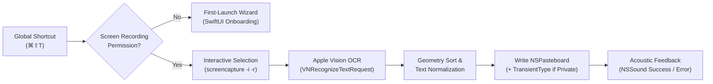

<div align="center">

# 🥢 Pluck

**Minimalist native macOS screen OCR. Sound is the only feedback.**

[](https://github.com/SyntaXPixel/Pluck/releases/latest)
[](https://github.com/SyntaXPixel/Pluck/releases/latest)
[](https://swift.org)
[](https://github.com/SyntaXPixel/Pluck/blob/main/LICENSE)
[](https://github.com/p0deje/Maccy)

<br />

[Download Latest (`Pluck.dmg`)](https://github.com/SyntaXPixel/Pluck/releases/latest/download/Pluck.dmg) · [Architecture](#-architecture--workflow) · [Build from Source](#-building-from-source)

</div>

---

## ⚡ Key Highlights & Philosophy

Most screen OCR utilities suffer from feature creep: persistent background daemons, intrusive notification banners, floating preview windows, cloud accounts, and heavy cross-platform wrappers.

**Pluck** is built around a single philosophy: **capture text from anywhere on screen as invisibly as copying regular text.**

| Metric / Behavior | Bloated OCR Apps | **Pluck** |
| :--- | :--- | :--- |
| **UI Footprint** | Dock icon + floating overlays | Menu bar agent only (`LSUIElement = true`) |
| **Capture Feedback** | Banners, toasts, modal popups | **Acoustic only** (native macOS system sounds) |
| **Idle CPU / Memory** | 1–5% CPU, 150MB+ Electron/WebView RAM | **0% idle CPU**, **<30MB RAM** |
| **OCR Engine** | Cloud APIs or bundled heavy binaries | Native Apple Vision (`VNRecognizeTextRequest`) |
| **Privacy & Telemetry** | Analytics SDKs & network calls | **100% offline, zero network permissions** |

---

## 🖥️ Visual Preview & Operation

```text
┌──────────────────────────────────────────────────────────────────────┐
│    File  Edit  View  Window  Help         [🥢]  🔋 100%  Wi-Fi  🕒  │
└──────────────────────────────────────────────┬───────────────────────┘
                                               │
                                    ┌──────────▼───────────────────────┐
                                    │  Pluck Text               ⌘⇧T    │
                                    │ ──────────────────────────────── │
                                    │  Recognition: Accurate        ✓  │
                                    │  Save to Clipboard History    ✓  │
                                    │ ──────────────────────────────── │
                                    │  Preferences…                 ⌘, │
                                    │  Quit Pluck                   ⌘Q │
                                    └──────────────────────────────────┘
```

### Clean Drag-and-Drop Installer (`Pluck.dmg`)

```text
┌──────────────────────────────────────────────────────────┐
│  ● ● ●                                                   │
│                                                          │
│                                                          │
│           [ 🥢 Pluck.app ]       ───►       [ 📁 Applications ]  │
│                                                          │
│                                                          │
└──────────────────────────────────────────────────────────┘
```

---

## ✨ Features

* **Global Shortcut (`⌘⇧T` default)**: Trigger region selection from any workspace or full-screen app. Fully customizable via [`KeyboardShortcuts`](https://github.com/sindresorhus/KeyboardShortcuts).
* **Apple Vision OCR Engine**: Powered by `VNRecognizeTextRequest` on the Apple Neural Engine.
  * Switch between **Accurate** and **Fast** recognition levels.
  * Automatic language detection and multi-line geometry sorting.
  * Smart post-processing for whitespace normalization and line-break hyphenation cleanup.
* **Acoustic Feedback**: Zero visual clutter. Configure distinct native system sounds for successful extraction vs. empty/canceled selections.
* **First-Class [Maccy](https://github.com/p0deje/Maccy) Integration**:
  * Pairs naturally with `org.p0deje.Maccy` for searchable clipboard history.
  * **Transient Privacy Mode**: When *"Save to History"* is toggled off, Pluck tags `NSPasteboard` items with `org.nspasteboard.TransientType`—allowing immediate `⌘V` pasting while instructing Maccy and other clipboard managers to ignore the entry.
* **First-Launch Onboarding Wizard**: Lightweight SwiftUI step-by-step assistant that verifies Screen Recording permissions and configures startup preferences.

---

## 📦 Download & Installation

### Direct Download

1. Download the latest universal disk image:
   👉 **[Download `Pluck.dmg` (Latest Release)](https://github.com/SyntaXPixel/Pluck/releases/latest/download/Pluck.dmg)**
2. Open `Pluck.dmg` and drag **Pluck.app** into your `/Applications` folder.
3. Launch **Pluck** from `/Applications` or Spotlight.
4. Follow the first-launch wizard to grant **Screen Recording** permission in `System Settings → Privacy & Security → Screen & System Audio Recording`.

> **Minimum System Requirements:** macOS 13.0+ (Ventura, Sonoma, Sequoia) · Apple Silicon & Intel Universal.

### Homebrew Cask *(Roadmap)*

```bash
# Coming soon to Homebrew Cask:
# brew install --cask pluck
```

---

## 🔄 Architecture & Workflow

Pluck uses an AppKit event lifecycle (`NSApplication` agent) with zero background polling. Memory is allocated strictly during the capture-to-pasteboard pipeline and released immediately after.



```text
[Shortcut ⌘⇧T] ──► [Permission Check] ──► [Screencapture] ──► [Vision OCR] ──► [Pasteboard] ──► [Sound Feedback]
```

---

## 🛠️ Building from Source

### Prerequisites

* **macOS 13.0+**
* **Xcode 15.0+** (with Command Line Tools installed)
* **XcodeGen** (`brew install xcodegen`)

### Build & Package Steps

```bash
# 1. Clone the repository
git clone https://github.com/SyntaXPixel/Pluck.git
cd Pluck

# 2. Generate the Xcode project from project.yml
xcodegen generate

# 3. Compile the Release app bundle
./scripts/build.sh

# 4. Package into a clean distributable DMG (build/Release/Pluck.dmg)
./scripts/make-dmg.sh
```

---

## 🙏 Credits & Prior Art

Pluck stands on the shoulders of outstanding open-source macOS software:

* **[macOCR](https://github.com/schappim/macOCR)** — Early inspiration for lightweight Vision-based screen OCR on macOS.
* **[Maccy](https://github.com/p0deje/Maccy)** — The gold-standard macOS clipboard manager and `org.nspasteboard.TransientType` convention.
* **[Sindre Sorhus](https://github.com/sindresorhus)** — Creator of [`KeyboardShortcuts`](https://github.com/sindresorhus/KeyboardShortcuts) and [`LaunchAtLogin-Modern`](https://github.com/sindresorhus/LaunchAtLogin-Modern), the only two external dependencies in Pluck.

---

## 📄 License

Released under the **MIT License**. See the full license text at:  
👉 **[https://github.com/SyntaXPixel/Pluck/blob/main/LICENSE](https://github.com/SyntaXPixel/Pluck/blob/main/LICENSE)**

Copyright © 2026 SyntaXPixel / Pluck Contributors.
