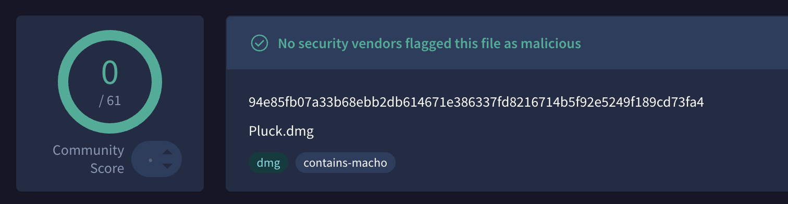

<div align="center">
  
  <h1>Pluck</h1>
  <p><strong>Lightweight native macOS screen OCR. Sound is the only feedback.</strong></p>

  <p>
    <a href="https://github.com/SyntaXPixel/Pluck/releases/latest"></a>
    <a href="https://github.com/SyntaXPixel/Pluck/releases/latest"></a>
    <a href="https://swift.org"></a>
    <a href="LICENSE"></a>
    <a href="https://buymeacoffee.com/syntaxpixel"></a>
  </p>

  <p>
    <a href="https://github.com/SyntaXPixel/Pluck/releases">Releases</a> &bull;
    <a href="https://github.com/SyntaXPixel/Pluck/releases/latest/download/Pluck.dmg">Download Pluck.dmg</a> &bull;
    <a href="#features">Features</a> &bull;
    <a href="#installation">Installation</a> &bull;
    <a href="#building-from-source">Build</a>
  </p>
</div>

---

## Overview

Pluck is an unobtrusive menu bar utility that extracts text from any screen selection using Apple Vision and copies it directly to your clipboard.

Feedback is strictly acoustic through macOS system sounds—no notification banners, toasts, or popup windows. Clipboard history is delegated to [Maccy](https://maccy.app) rather than maintained internally.

## Features

- **Menu Bar Resident**: Runs strictly as an agent without a dock icon (`LSUIElement = true`), with 0% idle CPU and under 30 MB RAM.
- **Sound-Only Feedback**: Auditory confirmation on success and error states. No notifications or modal dialogs.
- **Apple Vision OCR**: Powered by `VNRecognizeTextRequest` on the Apple Neural Engine. Supports Fast and Accurate modes, automatic language detection, reading-order geometry sorting, and whitespace cleanup.
- **Maccy Integration**: Integrates directly with Maccy. When "Save to History" is disabled, Pluck marks pasteboard items as transient so clipboard managers ignore them while standard paste continues to work.
- **Customizable Shortcut**: Trigger screen selection from any workspace using the default shortcut (`Control + Command + P` / `⌃⌘P`) or a custom key combination.
- **Privacy First**: Fully offline with no network permissions, no telemetry, and no background database.

## Installation

1. Download **[Pluck.dmg](https://github.com/SyntaXPixel/Pluck/releases/latest/download/Pluck.dmg)** from the [Releases](https://github.com/SyntaXPixel/Pluck/releases) page.
2. Open the disk image and drag **Pluck.app** to your `/Applications` folder.
3. Launch Pluck and grant **Screen Recording** permission when prompted by the setup wizard.

> **Requirements:** macOS 13.0 (Ventura) or later. Universal binary for Apple Silicon and Intel.

### Security & Gatekeeper Notice

Because Pluck is a self-funded open-source project without a paid Apple Developer certificate, macOS Gatekeeper may show a warning on first launch (*"Apple could not verify Pluck.app is free of malware"*).

Pluck is 100% offline, contains zero tracking or network code, and is verified clean:

- **SHA-256**: `94e85fb07a33b68ebb2db614671e386337fd8216714b5f92e5249f189cd73fa4`
- **VirusTotal Report**: [0/61 Detections on VirusTotal](https://www.virustotal.com/gui/file/94e85fb07a33b68ebb2db614671e386337fd8216714b5f92e5249f189cd73fa4)

<p align="center">
  <a href="https://www.virustotal.com/gui/file/94e85fb07a33b68ebb2db614671e386337fd8216714b5f92e5249f189cd73fa4">
    
  </a>
</p>

#### Opening Pluck on First Launch

- **Option A (System Settings)**: Open **System Settings &rarr; Privacy & Security**, scroll down to the **Security** section, and click **Open Anyway**.
- **Option B (Finder)**: In `/Applications`, right-click (or Control-click) **Pluck.app** and select **Open**.
- **Option C (Terminal)**: Run:
  ```bash
  xattr -cr /Applications/Pluck.app
  ```

## Usage

- **Capture Text**: Press `Control + Command + P` / `⌃⌘P` (or your configured shortcut), then drag to select a screen area.
- **Success**: A confirmation sound plays, and the extracted text is copied to your clipboard.
- **Cancel**: Press `Escape` during selection to cancel silently.
- **Preferences**: Click the menu bar icon and select **Preferences...** (`Command + ,`) to configure shortcuts, recognition accuracy, sound effects, and startup behavior.

## Building from Source

### Prerequisites

- macOS 13.0+
- Xcode 15+
- [XcodeGen](https://github.com/yonaskolb/XcodeGen) (`brew install xcodegen`)

### Build Commands

```bash
# Clone the repository
git clone https://github.com/SyntaXPixel/Pluck.git
cd Pluck

# Generate Xcode project
xcodegen generate

# Build release application bundle
./scripts/build.sh

# Create distributable DMG
./scripts/make-dmg.sh
```

## Support

If Pluck saves you time and clicks, you can support its development:

- **[Buy Me a Coffee](https://buymeacoffee.com/syntaxpixel)**

## Credits

- **[macOCR](https://github.com/schappim/macOCR)** by schappim — Inspiration for interactive macOS screen OCR.
- **[Maccy](https://maccy.app)** by p0deje — Clipboard history partner.
- **[KeyboardShortcuts](https://github.com/sindresorhus/KeyboardShortcuts)** and **[LaunchAtLogin-Modern](https://github.com/sindresorhus/LaunchAtLogin-Modern)** by Sindre Sorhus.

## License

This project is licensed under the [MIT Non-Commercial License (MIT-NC)](LICENSE).

It is free and open-source for personal and community use. Commercial use, monetization, or selling this software or its derivative works is strictly prohibited. All modifications and workflows must remain open source under the same terms.
